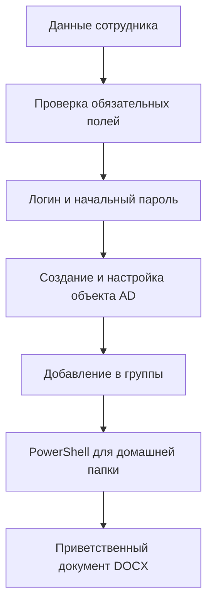

# AD User Tool

AD User Tool — настольная утилита на Python и Tkinter для первичного оформления доменной учётной записи сотрудника. Программа принимает кадровые и контактные данные, формирует логин и начальный пароль, создаёт объект пользователя в Active Directory через LDAPS, назначает атрибуты и группы, а затем выпускает PowerShell-сценарий для домашнего каталога и персональный документ Microsoft Word.

> [!IMPORTANT]
> Репозиторий содержит демонстрационный шаблон с вымышленными адресами, доменами, DN, группами и реквизитами организации. В текущем виде приложение нельзя использовать в рабочем домене: перед первым запуском необходимо настроить все значения, перечисленные в [руководстве по конфигурации](docs/CONFIGURATION.md), и выполнить проверку в изолированной тестовой OU.

## Назначение

Проект сокращает количество ручных действий при заведении нового сотрудника и помогает одинаково заполнять атрибуты Active Directory. Он рассчитан на администратора Windows-домена, который запускает приложение с рабочей станции, имеющей сетевой доступ к контроллеру домена и файловому серверу.

Утилита не является полноценной системой управления жизненным циклом учётных записей. Она выполняет один сценарий создания пользователя, не согласовывает заявку, не проверяет уникальность логина, не ведёт журнал операций и не откатывает уже выполненные изменения при частичном сбое.

## Возможности текущей версии

| Возможность | Реализация |
| --- | --- |
| Графический интерфейс | Одно окно Tkinter с девятью полями и кнопкой создания |
| Формирование логина | Первая буква имени и фамилия, затем транслитерация по схеме `iuliia.GOST_779_ALT` и удаление неалфавитно-цифровых символов |
| Начальный пароль | 9 символов в фиксированном порядке: заглавная буква, строчная буква, шесть цифр и один знак `#`, `!` или `@` |
| Подключение к AD | LDAP over SSL, TCP 636, аутентификация NTLM |
| Создание пользователя | Заполнение имени, UPN, почты, должности, подразделения, телефонов, кабинета, описания и реквизитов организации |
| Настройка учётной записи | Сброс пароля, разблокировка, включение обычной учётной записи и установка флага «пароль не истекает» |
| Группы безопасности | Добавление созданного DN пользователя в заранее заданные группы |
| Kerio Connect | Необязательные LDAP-атрибуты `kerio-Mail-AccountEnabled` и `kerio-Mail-Active` |
| Домашняя папка | Генерация отдельного PowerShell-файла, который задаёт диск `Z:`, создаёт каталог и назначает ACL `Modify` |
| Документ сотрудника | Формирование `.docx` из `welcome2.docx` через DocxTemplate |
| Русская раскладка | Обработка `Ctrl+C`, `Ctrl+X` и `Ctrl+V` в полях ввода при русской раскладке |
| Сборка | PyInstaller в режиме `--onefile --noconsole` через `build.ps1` |

## Как проходит создание пользователя



LDAP-часть выполняется первой. Если подключение к домену вызывает исключение, генерация локальных файлов не начинается. Ошибка при создании PowerShell-файла или документа Word показывается как предупреждение, но уже созданная учётная запись при этом не удаляется.

## Системные требования

| Компонент | Требование |
| --- | --- |
| Операционная система | Windows 10/11 или Windows Server с графическим сеансом |
| Python | Для запуска из исходников рекомендуется Python 3.12; совместимость с иными версиями должна проверяться отдельно |
| Сеть | Доступ к контроллеру домена по TCP 636 и к целевому файловому серверу |
| Active Directory | Сервисная учётная запись с делегированными правами на целевую OU, нужные атрибуты и группы |
| Сертификат LDAPS | Сертификат контроллера домена и доверенная цепочка; безопасная проверка сертификата требует доработки текущей конфигурации `ldap3` |
| Шаблон | Файл `welcome2.docx` в текущем рабочем каталоге приложения |
| PowerShell-сценарий | Модуль `ActiveDirectory` и права на изменение пользователя, создание каталога и ACL |
| Microsoft Word | Не требуется для генерации `.docx`; нужен только Word или совместимый редактор для просмотра результата |

## Быстрый запуск из исходников

Клонируйте репозиторий и перейдите в его каталог:

```powershell
git clone https://github.com/NetGraniz/ad_user_tool.git
Set-Location ad_user_tool
```

Создайте и активируйте виртуальное окружение:

```powershell
py -3.12 -m venv .venv
Set-ExecutionPolicy -Scope Process -ExecutionPolicy Bypass
.\.venv\Scripts\Activate.ps1
```

Установите зависимости:

```powershell
python -m pip install --upgrade pip
python -m pip install -r requirements.txt
```

До запуска замените демонстрационные значения в `ad_user_tool.py`. Полная карта параметров, DN и атрибутов приведена в [CONFIGURATION.md](docs/CONFIGURATION.md).

Запустите приложение из корня проекта, чтобы относительный путь к шаблону Word разрешился правильно:

```powershell
python .\ad_user_tool.py
```

## Работа с программой

Заполните обязательные поля «Фамилия», «Имя», «Должность», «Подразделение» и «Кабинет». Телефоны, номер рабочего места и описание можно оставить пустыми. Перед нажатием кнопки создания проверьте написание ФИО: программа применяет `.title()`, поэтому регистр аббревиатур может измениться.

После нажатия `To create` приложение выполняет все операции последовательно. При успешном завершении на экране показываются логин и начальный пароль, а в текущем рабочем каталоге появляются файлы `<логин>.ps1` и `<Фамилия Имя>.docx`.

PowerShell-файл не запускается автоматически. Администратор должен проверить путь, букву диска и модель разрешений, после чего выполнить сценарий в контексте учётной записи с необходимыми правами. Подробный рабочий регламент приведён в [USAGE.md](docs/USAGE.md).

## Сборка EXE

Сценарий сборки удаляет старые каталоги `build` и `dist`, активирует `.venv`, определяет путь к схемам `iuliia` и передаёт их PyInstaller:

```powershell
.\build.ps1
```

Результат создаётся по адресу:

```text
dist\ad_user_tool.exe
```

Текущий `build.ps1` включает в EXE схемы транслитерации, но не включает `welcome2.docx`. Для работы собранного приложения положите шаблон рядом с EXE и запускайте программу из этого каталога либо измените стратегию поиска ресурсов. Детали сборки и отладки описаны в [DEVELOPMENT.md](docs/DEVELOPMENT.md).

## Структура репозитория

| Путь | Назначение |
| --- | --- |
| `ad_user_tool.py` | Интерфейс, генерация реквизитов, LDAP-операции и создание выходных файлов |
| `welcome2.docx` | Шаблон персонального документа с переменными DocxTemplate |
| `requirements.txt` | Зафиксированные прямые и транзитивные зависимости среды разработки |
| `build.ps1` | Очистка предыдущей сборки и создание однофайлового EXE через PyInstaller |
| `.gitignore` | Исключения для виртуального окружения, кэша Python, результатов сборки и IDE |
| `docs/CONFIGURATION.md` | Настройка домена, OU, групп, Kerio, файлового сервера и шаблона |
| `docs/USAGE.md` | Пошаговый эксплуатационный регламент и проверка результата |
| `docs/ARCHITECTURE.md` | Архитектура, последовательность операций и точки расширения |
| `docs/DEVELOPMENT.md` | Среда разработки, сборка, диагностика и проверка изменений |
| `docs/TROUBLESHOOTING.md` | Причины типовых ошибок LDAP, Word, PowerShell и PyInstaller |
| `SECURITY.md` | Риски текущей реализации и требования перед рабочим внедрением |

## Документация

| Раздел | Когда использовать |
| --- | --- |
| [Конфигурация](docs/CONFIGURATION.md) | Перед первым подключением к тестовому или рабочему домену |
| [Эксплуатация](docs/USAGE.md) | При оформлении нового сотрудника и проверке результатов |
| [Архитектура](docs/ARCHITECTURE.md) | При сопровождении кода и планировании новых функций |
| [Разработка и сборка](docs/DEVELOPMENT.md) | При изменении исходников или выпуске EXE |
| [Диагностика](docs/TROUBLESHOOTING.md) | При ошибках подключения, LDAP-операций, шаблона или сборки |
| [Безопасность](SECURITY.md) | Перед передачей приложения администраторам и вводом в эксплуатацию |

## Критические ограничения текущей реализации

Вызовы `conn.add()` и `conn.modify()` возвращают результат операции, однако код его не проверяет. При стандартном режиме `ldap3` некоторые ошибки каталога могут не вызвать исключение, поэтому окно `Done` само по себе не подтверждает, что все изменения применены. После каждого запуска необходимо проверять объект в AD, членство в группах и домашний каталог.

Логин не проверяется на занятость. Повторная фамилия, одинаковые инициалы, составные имена и фамилии могут привести к коллизии или неожиданному имени входа. Пароль создаётся модулем `random`, который документация Python не рекомендует для генерации секретов. Значение `userAccountControl = 66048` включает обычную учётную запись и запрещает истечение пароля. Эти решения должны быть заменены или явно утверждены политикой организации до рабочего применения.

Секрет сервисной учётной записи сейчас хранится непосредственно в исходном коде. Не публикуйте реальные реквизиты в Git, не передавайте собранный EXE третьим лицам и не используйте административную учётную запись уровня Domain Admin. Полный перечень защитных мер приведён в [SECURITY.md](SECURITY.md).

## Проверка после изменений

| Проверка | Ожидаемый результат |
| --- | --- |
| Запуск из исходников | Окно открывается без traceback |
| Обязательные поля | Пустое значение останавливает операцию до подключения к AD |
| Транслитерация | Для контрольных ФИО получается ожидаемый уникальный `sAMAccountName` |
| LDAPS | Соединение устанавливается с доверенным контроллером домена |
| Создание объекта | Пользователь находится в заданной OU со всеми ожидаемыми атрибутами |
| Пароль и UAC | Вход возможен, а параметры срока действия соответствуют политике |
| Группы | Пользователь добавлен во все настроенные группы |
| PowerShell | Сценарий создаёт домашний каталог, задаёт `Z:` и ожидаемые ACL |
| Word | Документ открывается, а все четыре переменные заменены значениями |
| Сборка | `dist\ad_user_tool.exe` запускается на чистой тестовой машине |

## Статус проекта

Проект представляет собой рабочий прототип и демонстрацию автоматизации администрирования Active Directory. Перед промышленным использованием требуются вынос конфигурации и секретов из кода, криптографически стойкая генерация паролей, проверка результатов LDAP, защита LDAPS-сертификата, обработка коллизий логинов, журналирование и тесты.

В репозитории отсутствует файл лицензии. До добавления лицензии условия копирования, изменения и распространения проекта явно не определены.

## Официальные справочные материалы

Документация проекта опирается на [рекомендации Python по генерации секретов](https://docs.python.org/3/library/secrets.html), [описание флагов `userAccountControl` Microsoft](https://learn.microsoft.com/en-us/troubleshoot/windows-server/active-directory/useraccountcontrol-manipulate-account-properties), [руководство ldap3 по SSL/TLS](https://ldap3.readthedocs.io/en/latest/ssltls.html) и [руководство PyInstaller по добавлению файлов данных](https://pyinstaller.org/en/stable/spec-files.html#adding-data-files).
