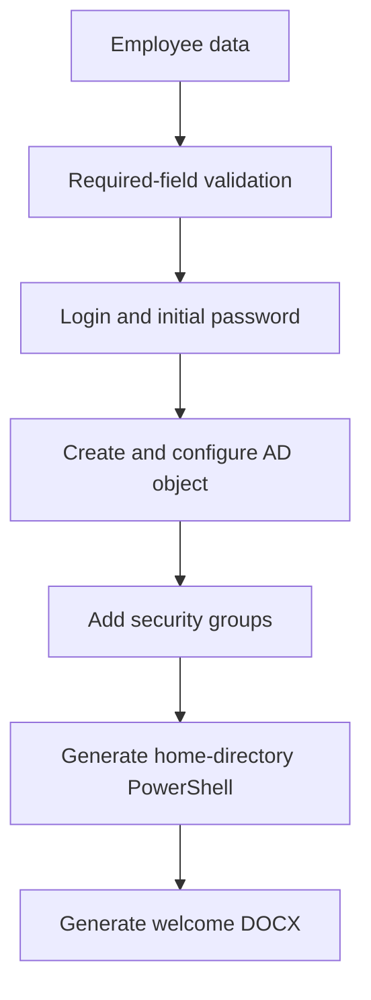

# AD User Tool

AD User Tool is a Python and Tkinter desktop utility for initial employee account provisioning. It accepts HR and contact data, generates a login and initial password, creates an Active Directory user over LDAPS, assigns attributes and groups, and then produces a PowerShell home-directory script and a personalised Microsoft Word document.

> [!IMPORTANT]
> This repository contains a demonstration template with fictional addresses, domains, distinguished names, groups, and organisation details. Do not use it in a production domain until every value listed in [CONFIGURATION.md](docs/CONFIGURATION.md) has been configured and the workflow has been verified in an isolated test OU.

## Scope

The tool reduces repetitive work when onboarding an employee and helps populate AD attributes consistently. It is intended for a Windows-domain administrator whose workstation can reach the domain controller and file server.

It is not a complete account-lifecycle platform. It performs one user-creation workflow, does not approve requests, does not check login uniqueness, does not maintain an audit log, and does not roll back completed operations after a partial failure.

## Current capabilities

- Tkinter interface with nine input fields.
- Login generation from the first-name initial and surname using `iuliia.GOST_779_ALT` transliteration.
- Nine-character initial passwords using the current fixed character pattern.
- LDAPS on TCP 636 with NTLM authentication.
- User creation with UPN, email, title, department, phone, office, description, and organisation attributes.
- Password reset, account unlock and enablement, and the current non-expiring-password flag.
- Membership in configured security groups.
- Optional Kerio Connect LDAP attributes.
- A generated PowerShell script for drive `Z:`, directory creation, and `Modify` ACLs.
- A personalised `.docx` built from `welcome2.docx` with DocxTemplate.
- PyInstaller `--onefile --noconsole` packaging through `build.ps1`.

## Workflow



LDAP work runs first. If the domain connection raises an exception, local output files are not created. A later PowerShell or Word-generation failure is shown as a warning, but the already-created AD account is not removed.

## Requirements

- Windows 10/11 or Windows Server with a graphical session.
- Python 3.12 recommended for source execution.
- TCP 636 access to the domain controller and access to the target file server.
- A least-privilege service account delegated to the target OU and groups.
- A trusted LDAPS certificate chain; strict certificate verification still requires configuration work.
- `welcome2.docx` in the application's working directory.
- The PowerShell `ActiveDirectory` module and permissions for user, directory, and ACL changes.

## Run from source

```powershell
git clone https://github.com/NetGraniz/ad_user_tool.git
Set-Location ad_user_tool
py -3.12 -m venv .venv
Set-ExecutionPolicy -Scope Process -ExecutionPolicy Bypass
.\.venv\Scripts\Activate.ps1
python -m pip install --upgrade pip
python -m pip install -r requirements.txt
python .\ad_user_tool.py
```

Replace every demonstration value before launch. The full map of domains, DNs, groups, attributes, and file-server settings is in [CONFIGURATION.md](docs/CONFIGURATION.md).

Required fields are surname, first name, title, department, and office. After successful completion, the application displays the login and initial password and writes `<login>.ps1` plus `<Surname Firstname>.docx` to the working directory. Review the generated PowerShell script before running it with delegated credentials. See [USAGE.md](docs/USAGE.md).

## Build

```powershell
.\build.ps1
```

The executable is written to `dist\ad_user_tool.exe`. Transliteration schemas are bundled, but `welcome2.docx` is not; place the template beside the EXE or change the resource lookup strategy. See [DEVELOPMENT.md](docs/DEVELOPMENT.md).

## Documentation

- [Configuration](docs/CONFIGURATION.md) — domains, OUs, groups, Kerio, file server, and templates.
- [Usage](docs/USAGE.md) — operator workflow and result verification.
- [Architecture](docs/ARCHITECTURE.md) — operation order and extension points.
- [Development](docs/DEVELOPMENT.md) — environment, build, diagnostics, and checks.
- [Troubleshooting](docs/TROUBLESHOOTING.md) — LDAP, Word, PowerShell, and PyInstaller failures.
- [Security](SECURITY.md) — risks and production-readiness requirements.

## Critical limitations

The current code does not inspect the result objects returned by every `conn.add()` and `conn.modify()` call. Some `ldap3` directory failures may therefore not raise an exception; a **Done** dialog does not prove that every change succeeded. Verify the AD object, group membership, and home directory after every run.

Login availability is not checked. Duplicate surnames, initials, and compound names may collide. The initial password uses Python's `random` module rather than the `secrets` module. `userAccountControl = 66048` enables a standard account and disables password expiry. These decisions must be replaced or explicitly approved by organisational policy before production use.

The service-account credential is currently stored in source code. Never commit real credentials, distribute a configured EXE, or use Domain Admin. Move configuration and secrets out of source, use cryptographically secure password generation, validate LDAP results and certificates, handle login collisions, and add audit logging and tests before production deployment.

## Verification checklist

Verify source startup, required-field rejection, deterministic transliteration, trusted LDAPS, correct OU attributes, password and UAC policy, group membership, the generated home-directory ACLs, DOCX replacement fields, and execution of the packaged EXE on a clean test machine.

This project is a working prototype and administration-automation demonstration.

Licensed under the MIT License. See [LICENSE](LICENSE).
