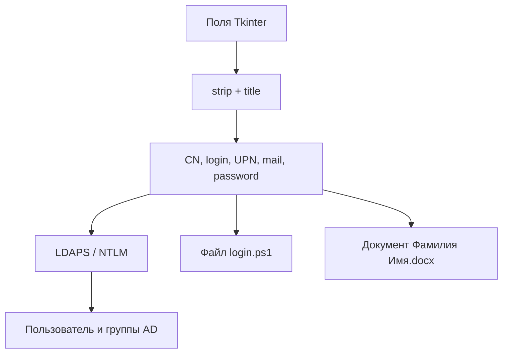
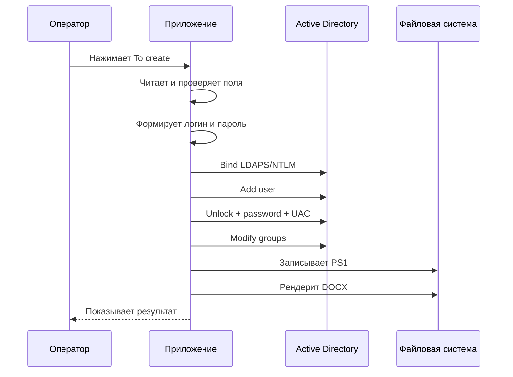
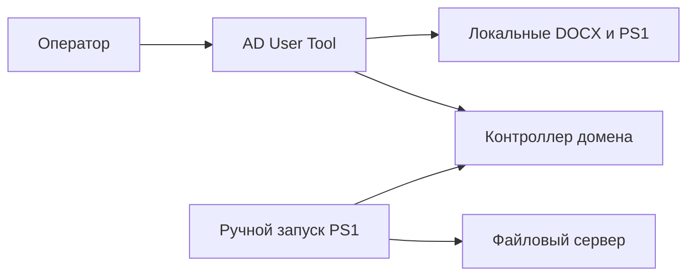

# Архитектура AD User Tool

## Обзор

Проект реализован одним исполняемым модулем `ad_user_tool.py`. В нём одновременно находятся графический интерфейс, бизнес-правила формирования реквизитов, конфигурация инфраструктуры, LDAP-клиент и генерация выходных файлов. Такой формат удобен для прототипа, но связывает интерфейс с административными операциями и усложняет тестирование.

Приложение работает синхронно. Обработчик кнопки выполняется в главном потоке Tkinter, поэтому во время сетевого запроса интерфейс не обрабатывает события окна.

## Компоненты

| Компонент | Расположение | Ответственность |
| --- | --- | --- |
| Генератор пароля | `generate_password()` | Создаёт строку из 9 символов фиксированного формата |
| Поддержка буфера обмена | `bind_russian_clipboard(widget)` | Сопоставляет keycode русской раскладки с виртуальными событиями Copy/Cut/Paste |
| Оркестратор создания | `create_user()` | Читает форму, проверяет поля, формирует реквизиты, изменяет AD и создаёт файлы |
| LDAP-конфигурация | Локальные переменные в `create_user()` | Хранит сервер, сервисную учётную запись и DN целевой OU |
| LDAP-клиент | `ldap3.Server` и `ldap3.Connection` | Подключается по LDAPS/NTLM и выполняет операции каталога |
| Генератор PS1 | Блок записи `f'''...'''` | Создаёт сценарий домашнего каталога и ACL |
| Генератор DOCX | `DocxTemplate` | Подставляет четыре значения в `welcome2.docx` |
| GUI | Глобальные объекты Tkinter | Создаёт окно, подписи, поля и кнопку |
| Сборка | `build.ps1` | Запускает PyInstaller и включает схемы iuliia |

## Поток данных



Исходные данные существуют только в памяти процесса и глобальных виджетах. Постоянное локальное состояние создаётся в двух выходных файлах. Серверное состояние записывается в Active Directory. Встроенного журнала, базы данных и файла состояния нет.

## Последовательность `create_user()`



### Чтение и нормализация формы

Каждое значение извлекается через `.get()`, очищается методом `.strip()`, а имя, фамилия, должность и подразделение дополнительно преобразуются `.title()`. Обязательными считаются имя, фамилия, должность, подразделение и кабинет. При отсутствии любого из них показывается `messagebox.showerror`, и обработчик завершается до сетевых операций.

Пустые необязательные поля заменяются строкой из одного пробела. Номер рабочего места присоединяется к кабинету как `<room> - <numWS>`.

### Идентификаторы пользователя

`fname` строится как `<Фамилия> <Имя>` и используется для CN, displayName и имени DOCX. Логин строится из первого символа имени и первого элемента после имени в строке `source_name`. После транслитерации через `GOST_779_ALT` остаются только символы, для которых `str.isalnum()` возвращает `True`.

Алгоритм не имеет слоя разрешения коллизий. Он не выполняет LDAP-поиск до `conn.add()` и не добавляет числовой суффикс.

### Пароль

`generate_password()` последовательно вызывает функции модуля `random`: выбирает одну заглавную букву, одну строчную, шесть цифр и один специальный символ. Позиции классов символов не перемешиваются.

Энтропия и соответствие доменной политике не вычисляются. Ошибка ограничения пароля может возникнуть только во время LDAP-операции установки пароля.

### Создание объекта AD

Подключение создаётся с `auto_bind=True`, поэтому ошибка установления соединения или NTLM-bind обычно проявляется при создании `Connection`. DN пользователя имеет вид:

```text
cn=<Фамилия Имя>,<usersOU>
```

Метод `conn.add()` получает объектный класс `user` и словарь атрибутов. После этого вызываются расширения Microsoft для разблокировки и установки пароля. Затем `conn.modify()` заменяет `userAccountControl` на `66048`.

### Добавление в группы

Для каждого DN из списка `groups` выполняется модификация атрибута `member` с операцией `MODIFY_ADD`. Группы обрабатываются последовательно. Результат отдельной модификации не сохраняется и не выводится оператору.

### Генерация PowerShell

Файл `<login>.ps1` создаётся через обычный `open(..., encoding="utf-8")` в текущем рабочем каталоге. В строковый шаблон подставляется только логин; корневой UNC-путь и буква диска зафиксированы в тексте Python.

Сценарий PS1 не выполняется приложением. Он является отдельным административным артефактом и требует модуля ActiveDirectory при последующем ручном запуске.

### Генерация Word

`DocxTemplate("welcome2.docx")` открывает внешний файл по относительному пути. Контекст содержит `name`, `login`, `email` и `password`. Сохранение идёт в `<Фамилия Имя>.docx` текущего рабочего каталога.

Шаблон не включён в команду PyInstaller. Это означает, что собранный EXE продолжает зависеть от внешнего `welcome2.docx` и корректного рабочего каталога.

## Обработка ошибок

| Область | Механизм | Последствие |
| --- | --- | --- |
| Валидация формы | Явная проверка пустых обязательных полей | Операция не начинается |
| AD-блок | Один широкий `try/except Exception` | Показывается `AD Error`, локальные файлы не создаются |
| Запись PS1 | Отдельный `try/except` | Показывается предупреждение, затем продолжается DOCX |
| Генерация DOCX | Отдельный `try/except` | Показывается предупреждение, затем появляется итоговое `Done` |
| LDAP-коды результата | Не анализируются | Ошибка каталога может не превратиться в исключение |

ldap3 по умолчанию часто сообщает результат операции через возвращаемое значение и `conn.result`. Поскольку код их не проверяет, логика ошибок не гарантирует, что переход к следующему шагу означает успех предыдущего.

Обратной операции нет. Если объект создан, но более поздний шаг не выполнен, приложение не удаляет пользователя, не снимает членство и не удаляет файлы.

## Зависимости

| Пакет | Роль в проекте |
| --- | --- |
| `ldap3` | LDAP v3, NTLM, операции Microsoft AD и модификации атрибутов |
| `iuliia` | Транслитерация имени входа по `GOST_779_ALT` |
| `docxtpl` | Рендеринг Jinja2-переменных в DOCX |
| `python-docx` | Основа работы с форматом Word, используется через стек docxtpl |
| `Jinja2` | Шаблонизация значений документа |
| `lxml` | Обработка XML внутри DOCX |
| `pyinstaller` | Создание автономного Windows EXE |
| `pyinstaller-hooks-contrib` | Дополнительные хуки анализа зависимостей PyInstaller |
| `tkinter` | Стандартный GUI-модуль Python; в `requirements.txt` не устанавливается |
| `random`, `string`, `os` | Стандартная библиотека: пароль, наборы символов и пути |

`requirements.txt` создан как полный снимок окружения и содержит также транзитивные и сборочные пакеты. Разделение runtime- и dev-зависимостей пока не реализовано.

## Границы доверия



Приложение доверяет введённым ФИО и атрибутам, локальному шаблону Word, конфигурации в исходнике, контроллеру на указанном адресе и ответам LDAP. Сгенерированный PS1 создаёт вторую административную границу: его может проверить и запустить другой оператор с иным набором прав.

## Ограничения масштабирования

Синхронный интерфейс подходит для единичных операций, но не для пакетного импорта. Глобальные виджеты затрудняют повторное использование логики без окна. Настройки внутри функции не позволяют безопасно переключать окружения. Отсутствие уникальных идентификаторов операции и журналирования мешает восстановлению после частичного сбоя.

## Рекомендуемое разделение при развитии

| Новый модуль | Ответственность |
| --- | --- |
| `config.py` | Загрузка и проверка несекретной конфигурации |
| `credentials.py` | Получение секрета из поддерживаемого защищённого источника |
| `identity.py` | Нормализация ФИО, логин, проверка коллизий и пароль |
| `ad_service.py` | Подключение, TLS, создание, проверка результатов и компенсирующие действия |
| `home_directory.py` | Формирование или непосредственное выполнение безопасной настройки каталога |
| `document_service.py` | Поиск ресурсов, рендеринг и защищённое сохранение DOCX |
| `ui.py` | Только интерфейс, предварительный просмотр и отображение прогресса |
| `models.py` | Структуры входных данных и результата операции |
| `logging_config.py` | Аудит без записи паролей и других секретов |

Такое разделение позволит тестировать генерацию логина и LDAP-запросы отдельно, выполнять операции в фоновом потоке, показывать предварительный результат и корректно обрабатывать частичный успех.

## Точки расширения

Наиболее полезные следующие изменения — предварительная проверка логина в AD, числовые суффиксы при коллизии, выбор OU и групп по роли, конфигурация вне кода, `secrets` для паролей, требование смены при первом входе, проверка TLS, анализ `conn.result`, структурированный журнал, dry-run, пакетный импорт CSV и тесты с mock-стратегией ldap3.

Перед расширением необходимо определить модель авторизации: какие параметры оператор может выбирать, какие зафиксированы политикой, кто утверждает повышенные группы и где хранится доказательство выполнения заявки.

## Связанные разделы

Рабочие значения описаны в [CONFIGURATION.md](CONFIGURATION.md), эксплуатационная последовательность — в [USAGE.md](USAGE.md), сборка и проверка — в [DEVELOPMENT.md](DEVELOPMENT.md), а риски — в [SECURITY.md](../SECURITY.md).
