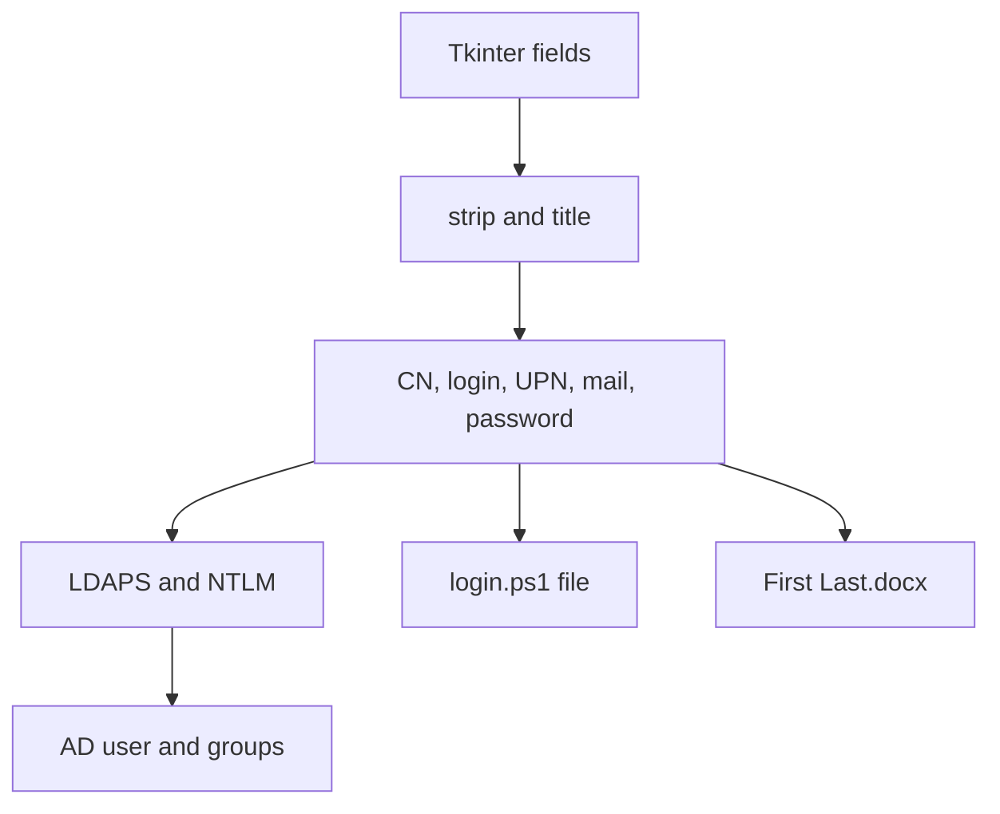
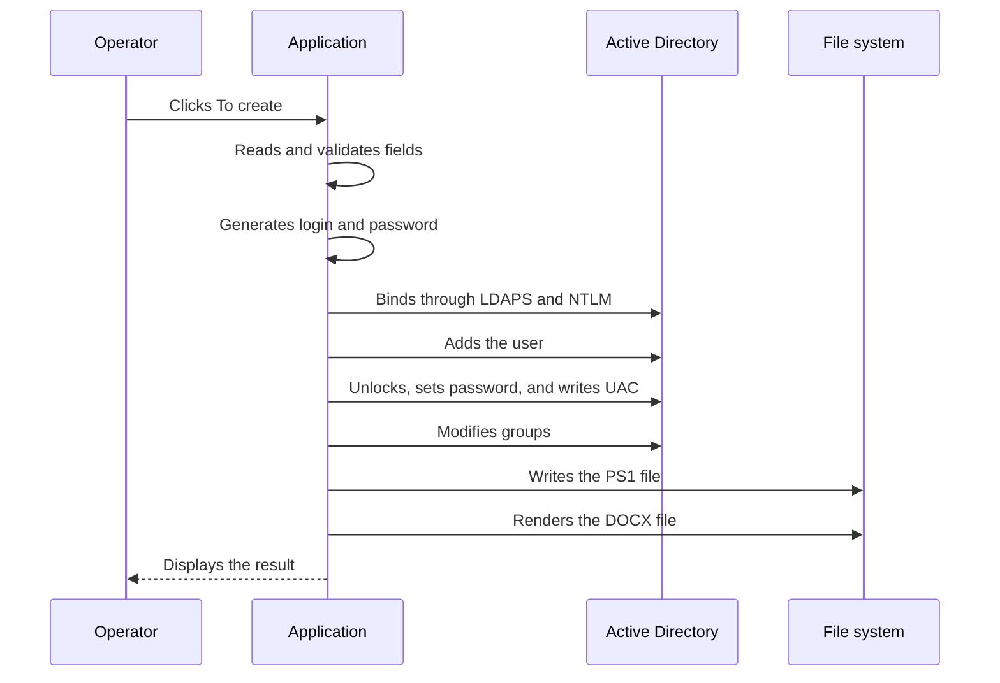
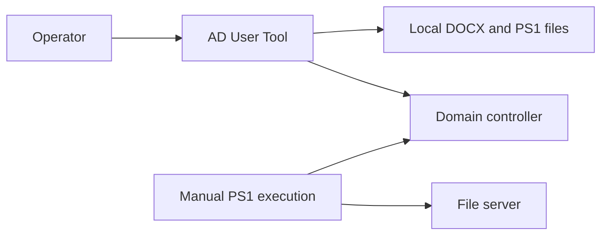

# AD User Tool Architecture

## Overview

The project consists of one executable module, `ad_user_tool.py`. It contains the GUI, credential-generation rules, infrastructure configuration, LDAP client, and output-file generation. This structure is convenient for a prototype, but tightly couples the interface to administrative operations and makes testing difficult.

The application is synchronous. The button handler runs in Tkinter's main thread, so the interface cannot process window events while a network request is in progress.

## Components

| Component | Location | Responsibility |
| --- | --- | --- |
| Password generator | `generate_password()` | Creates a 9-character string with a fixed format |
| Clipboard support | `bind_russian_clipboard(widget)` | Maps Russian-layout key codes to Copy, Cut, and Paste virtual events |
| Provisioning orchestrator | `create_user()` | Reads the form, validates fields, generates credentials, modifies AD, and creates files |
| LDAP configuration | Local variables in `create_user()` | Stores the server, service account, and target OU DN |
| LDAP client | `ldap3.Server` and `ldap3.Connection` | Connects through LDAPS and NTLM and performs directory operations |
| PS1 generator | The `f'''...'''` write block | Produces the home-directory and ACL script |
| DOCX generator | `DocxTemplate` | Inserts four values into `welcome2.docx` |
| GUI | Global Tkinter objects | Creates the window, labels, input fields, and button |
| Build | `build.ps1` | Runs PyInstaller and includes the iuliia schemas |

## Data flow



Input data exists only in process memory and global widgets. The two output files provide persistent local state, while Active Directory stores the server-side state. There is no built-in log, database, or state file.

## The `create_user()` sequence



### Form input and normalization

Each value is read through `.get()` and cleaned with `.strip()`. First name, surname, title, and department are also transformed with `.title()`. First name, surname, title, department, and room are required. If any required value is missing, `messagebox.showerror` is displayed and execution stops before any network operation.

Empty optional fields become a single-space string. The workstation number is appended to the room as `<room> - <numWS>`.

### User identifiers

`fname` is built as `<Surname> <First name>` and is used for the CN, display name, and DOCX filename. The login combines the first character of the first name with the first surname token. After `GOST_779_ALT` transliteration, only characters for which `str.isalnum()` returns `True` remain.

There is no collision-resolution layer. The application performs no LDAP search before `conn.add()` and does not add a numeric suffix.

### Password

`generate_password()` calls functions from `random` in sequence: one uppercase letter, one lowercase letter, six digits, and one special character. Character-class positions are not shuffled.

The application does not calculate entropy or prevalidate the domain password policy. A password restriction may therefore surface only during the LDAP password operation.

### AD object creation

The connection uses `auto_bind=True`, so connection or NTLM bind failures normally occur while constructing `Connection`. The user DN has this form:

```text
cn=<Surname First name>,<usersOU>
```

`conn.add()` receives the `user` object class and an attribute dictionary. Microsoft extensions then unlock the account and set its password. Finally, `conn.modify()` replaces `userAccountControl` with `66048`.

### Group membership

For each DN in `groups`, the code modifies the `member` attribute with `MODIFY_ADD`. Groups are processed sequentially. The result of each modification is neither retained nor shown to the operator.

### PowerShell generation

The application creates `<login>.ps1` in the current working directory with `open(..., encoding="utf-8")`. Only the login is inserted into the template; the root UNC path and drive letter are fixed in the Python source.

The application does not execute the PS1 file. It is a separate administrative artifact that requires the ActiveDirectory module when run manually.

### Word generation

`DocxTemplate("welcome2.docx")` opens an external relative path. Its context contains `name`, `login`, `email`, and `password`. The rendered document is saved as `<Surname First name>.docx` in the current working directory.

The PyInstaller command does not include the template. A packaged EXE still depends on an external `welcome2.docx` file and the correct working directory.

## Error handling

| Area | Mechanism | Result |
| --- | --- | --- |
| Form validation | Explicit required-field checks | The operation does not start |
| AD block | One broad `try/except Exception` | `AD Error` is shown and local files are not created |
| PS1 write | Separate `try/except` | A warning is shown, then DOCX generation continues |
| DOCX generation | Separate `try/except` | A warning is shown, then the final `Done` dialog appears |
| LDAP result codes | Not inspected | A directory failure may not become an exception |

ldap3 often reports an operation result through its return value and `conn.result`. Because the current code checks neither, reaching the next step does not prove the previous step succeeded.

There is no compensating operation. If the object is created but a later step fails, the application does not delete the user, reverse group membership, or remove files.

## Dependencies

| Package | Role |
| --- | --- |
| `ldap3` | LDAP v3, NTLM, Microsoft AD operations, and attribute modification |
| `iuliia` | Login transliteration through `GOST_779_ALT` |
| `docxtpl` | Rendering Jinja2 variables into DOCX |
| `python-docx` | Word-format foundation used by the docxtpl stack |
| `Jinja2` | Document value templating |
| `lxml` | XML handling inside DOCX files |
| `pyinstaller` | Standalone Windows EXE creation |
| `pyinstaller-hooks-contrib` | Additional PyInstaller dependency-analysis hooks |
| `tkinter` | Standard Python GUI module; not installed through `requirements.txt` |
| `random`, `string`, `os` | Standard library support for passwords, character sets, and paths |

`requirements.txt` is a complete environment snapshot that includes transitive and build dependencies. Runtime and development dependencies are not separated.

## Trust boundaries



The application trusts operator-provided names and attributes, the local Word template, source-code configuration, the controller at the configured address, and LDAP responses. The generated PS1 creates another administrative boundary because a different operator with different privileges may review and execute it.

## Scaling constraints

The synchronous UI is suitable for individual operations but not batch imports. Global widgets make it difficult to reuse business logic without opening a window. Configuration inside a function prevents safe environment switching. Missing operation IDs and audit logs complicate recovery from partial failures.

## Recommended modular design

| New module | Responsibility |
| --- | --- |
| `config.py` | Load and validate non-secret configuration |
| `credentials.py` | Retrieve the service secret from a supported protected source |
| `identity.py` | Normalize names, generate logins and passwords, and handle collisions |
| `ad_service.py` | Connect, validate TLS, create users, inspect results, and apply compensating actions |
| `home_directory.py` | Generate or safely perform home-directory configuration |
| `document_service.py` | Resolve resources, render DOCX, and save it securely |
| `ui.py` | Display the interface, preview, and progress only |
| `models.py` | Define input and operation-result structures |
| `logging_config.py` | Configure auditing without passwords or other secrets |

This design would allow login generation and LDAP requests to be tested independently, move operations to a background thread, preview results, and report partial success accurately.

## Extension points

The most useful next changes are AD login preflight checks, numeric collision suffixes, role-based OU and group selection, external configuration, `secrets` password generation, first-sign-in password changes, TLS validation, `conn.result` checks, structured auditing, dry-run mode, CSV batch import, and tests using ldap3's mock strategy.

Before expanding the tool, define its authorization model: which values an operator may choose, which values policy fixes, who approves privileged groups, and where request completion evidence is retained.

## Related documentation

See [Configuration](CONFIGURATION.md) for environment values, [Usage](USAGE.md) for the operator sequence, [Development](DEVELOPMENT.md) for build and verification, and [Security](../SECURITY.md) for risks.
